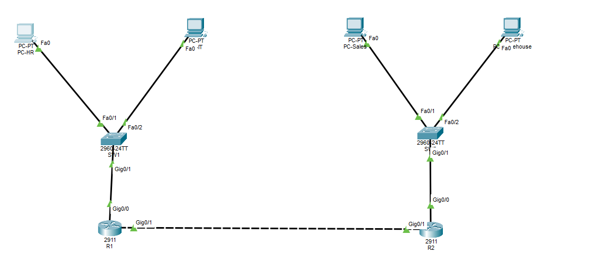

# Two Site Company Network

A small company network built in **Cisco Packet Tracer**: a head office and a branch, each with two departments on their own VLANs, connected with OSPF.

## What it uses

- **VLANs** to keep each department on its own network
- **Router on a stick** (subinterfaces) for routing between VLANs
- **DHCP** on each router to hand out addresses
- **OSPF** to share routes between the two sites

## Addressing

| Site | VLAN | Department | Network | Gateway |
|---|---|---|---|---|
| Head office | 10 | HR | 192.168.10.0/24 | 192.168.10.1 |
| Head office | 20 | IT | 192.168.20.0/24 | 192.168.20.1 |
| Branch | 30 | Sales | 192.168.30.0/24 | 192.168.30.1 |
| Branch | 40 | Warehouse | 192.168.40.0/24 | 192.168.40.1 |
| Link | | R1 to R2 | 10.0.0.0/30 | R1 .1, R2 .2 |

## Devices

| Device | Model | Connections |
|---|---|---|
| R1 | Cisco 2911 | Gi0/0 to SW1 (trunk), Gi0/1 to R2 |
| R2 | Cisco 2911 | Gi0/0 to SW2 (trunk), Gi0/1 to R1 |
| SW1 | Cisco 2960 | Fa0/1 HR PC, Fa0/2 IT PC, Gi0/1 to R1 |
| SW2 | Cisco 2960 | Fa0/1 Sales PC, Fa0/2 Warehouse PC, Gi0/1 to R2 |

## Checking it works

- PCs get an address from DHCP (`ipconfig`)
- PCs in different departments can ping each other
- `show ip ospf neighbor` on R1 shows R2 as FULL
- `show ip route` on R1 shows the branch networks learned through OSPF (O)

## Files

- `Two-Site-Network.pkt`: the Packet Tracer project
- `configs/`: running config from each router and switch
- `docs/network-documentation.xlsx`: VLAN, addressing, port, DHCP and routing tables
